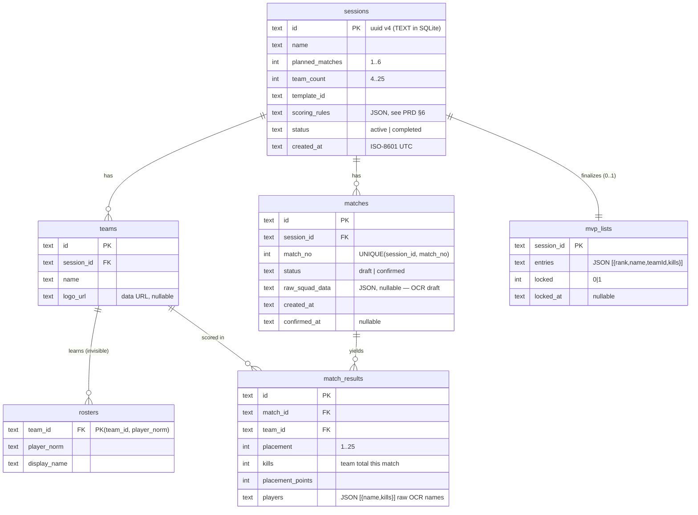

# SCRIMLYPRO — ENTITY RELATIONSHIP DOCUMENT (v1-CORE)

**Status:** ACTIVE · Single source of truth for DATA.
Companions: `PRD.md` (what), `PLAN.md` (build order).

## 1. Diagram



## 2. SQLite implementation mapping

Implemented via Drizzle + better-sqlite3 at `./data/scrimly.db` (gitignored; folder auto-created). Type mapping: `uuid` → `TEXT`, `jsonb` → `TEXT` via Drizzle mode:"json" + $type<> (no separate helpers), `timestamptz` → `TEXT` ISO-8601 UTC, `boolean` → `INTEGER`. IDs are uuid v4 generated in app code.

**Constraints** (enforced in app layer + checked in tests): `planned_matches` 1–6 · `team_count` 4–25 · `match_no` 1..planned · `placement` 1..team_count · squad 1–4 players · `UNIQUE(session_id, name)` on teams · `UNIQUE(session_id, match_no)` on matches.

**Indexes:** `teams(session_id)`, `rosters(team_id)`, `matches(session_id)`, `match_results(match_id)`, `match_results(team_id)`.

## 3. Standings derivation (THE cumulative computation)

Never stored. Single implementation in `lib/scoring` used by both the HTML standings table and the graphic (one source, two consumers).

```sql
-- documentation sketch; the TS function is authoritative
SELECT t.id, t.name,
       COUNT(*) FILTER (WHERE r.placement = 1)            AS wwcd,
       SUM(r.placement_points)                            AS pp,
       SUM(r.kills)                                       AS kp,
       SUM(r.kills) + SUM(r.placement_points)             AS total
FROM match_results r
JOIN matches m ON m.id = r.match_id AND m.status = 'confirmed'
JOIN teams   t ON t.id  = r.team_id
GROUP BY t.id
ORDER BY total DESC, wwcd DESC, kp DESC, pp DESC, t.name ASC;
```

## 4. Roster learning (suggestion data — never rendered)

On confirm of match N: upsert every mapped squad's player names (normalized per `lib/matching/normalize`) under the mapped team; `display_name` = first-seen raw spelling. On unlock of a match: rebuild rosters from remaining confirmed matches only.

## 5. Iron rules

- No aggregate columns anywhere. Standings, MVP totals, WWCD counts are always derived. Fixing/deleting any match is therefore always safe.
- `mvp_lists.entries` is written once on Lock and is the ONLY source for the MVP graphic afterward.
- Unlock = delete that match's `match_results` + `status→draft` + rosters rebuild (order matters; do it in one transaction).
- Re-confirm of a draft replaces its results idempotently.
- `rosters` is invisible plumbing — never shown in any UI.

## 6. Port to Supabase (future phase — deltas only, do not build now)

- `sessions.user_id` uuid + `auth.users` FK; RLS "own rows" policies on all tables (owner-check via session join).
- `TEXT` → native `uuid` / `jsonb` / `timestamptz`.
- Team logos → Storage bucket paths (replace data URLs).
- New tables then: `ocr_usage(user_id, day, count)` rate limiting; `shared_links(session_id, graphic_type, storage_path)` for publish/OG.
- MVP aggregation and standings SQL move server-side unchanged.